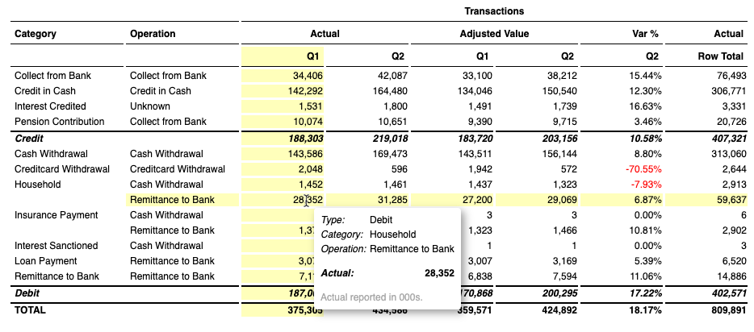
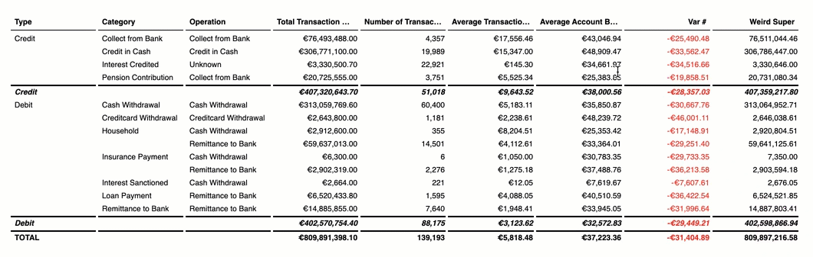
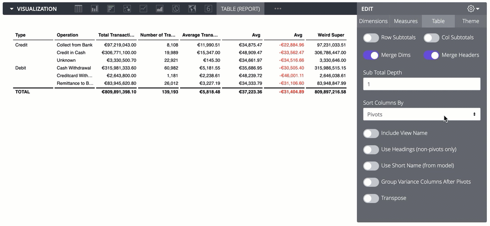
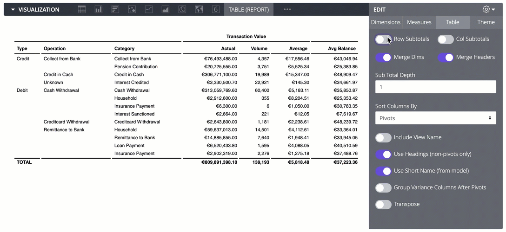
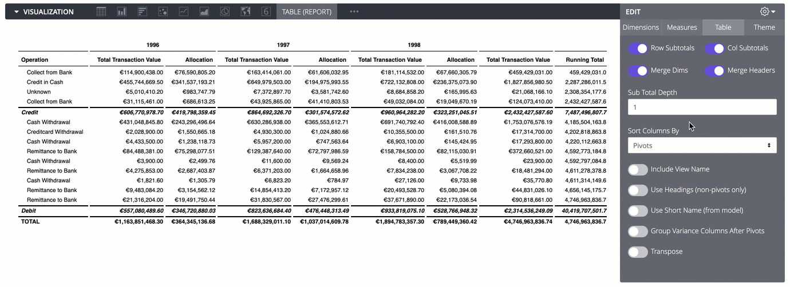
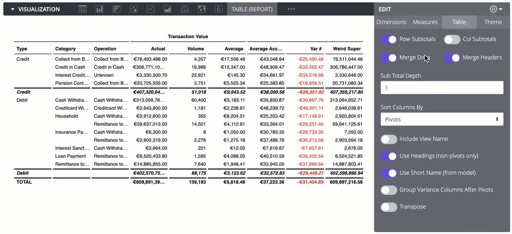
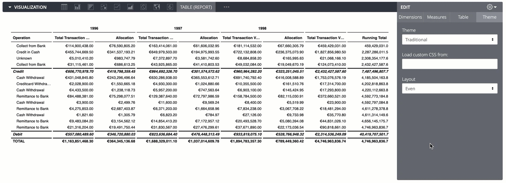
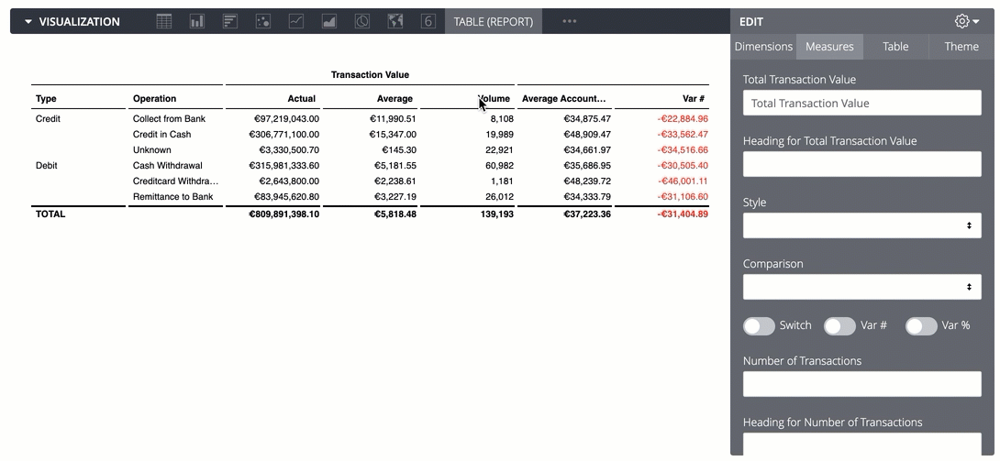
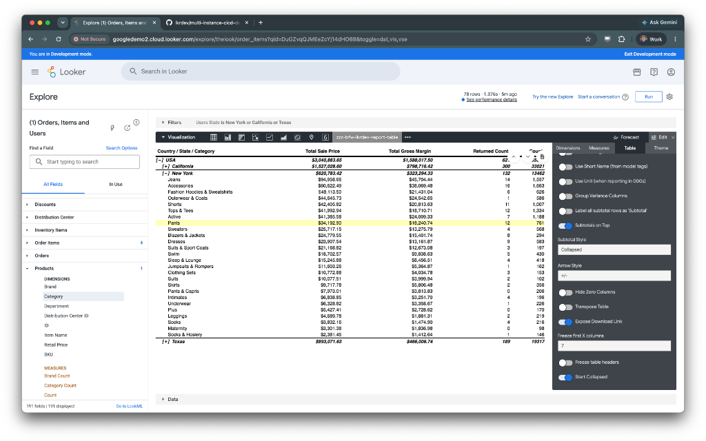
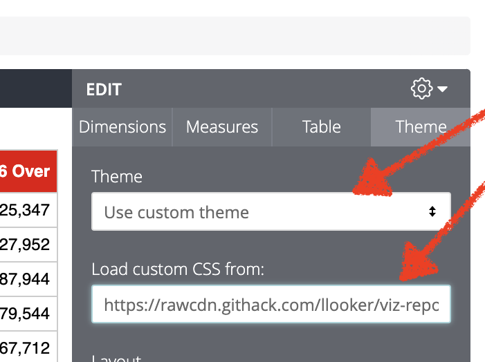

# Report Table for Looker

A table visualization for single-page summary reports in Looker, built for PDF exports, report packs, and financial statements. Originally created by [Jon Walls](https://github.com/ContrastingSounds/vis-report_table).



## Features

- Quick variance calculations
- Row and column subtotals across up to two pivot levels, using Looker query subtotals when available or calculating them in the browser
- Header rows on non-pivoted tables
- Column ordering by pivot value or measure, plus drag-and-drop column reordering for dimensions and measures on flat and pivoted tables
- Dimension transposition for P&L and financial layouts
- Red and black conditional formatting
- Subtotal row styling for transposed measures
- Custom CSS themes
- LookML tags for default headings, short names, and units
- Single-column dimension reduction for compact financial reports
- Looker drill menus

## Recent updates

- Per-user table and filter state persistence in the Looker Extension build (**Allow User Edits** and **Save and Apply User Filter State** in the **Theme** tab), with a floating **Reset Edits** button on hover.
- Drag-and-drop header reordering toggles (**Reorder Dimensions** and **Reorder Measures**) in the **Theme** tab for flat and pivoted tables.
- Optional floating Sigma (`Σ`) button on hover (**Allow Subtotal Toggle**) to show or hide row subtotals without re-running the query.
- Collapsed subtotal hierarchies with expand/collapse row controls, indentation levels, and combined dimension headers.
- **Subtotals on Top** toggle to place subtotal rows above their detail rows.
- Frozen left columns and frozen table headers during scrolling.
- Dynamic field label updates from Looker `label_from_parameter` and Liquid logic.
- **Hide Null Dimension Columns** setting to drop empty dimension columns and skip redundant subtotals on inactive hierarchy levels.

## Installation

Add Report Table to your Looker project's `manifest.lkml` either as a standard custom visualization or as a Looker Extension visualization.

### Custom visualization

```lookml
visualization: {
  id: "lkrdev-report-table"
  url: "https://cdn.lkr.dev/viz/report-table/latest/report_table.js"
  label: "Report Table"
}
```

### Looker extension visualization

Installing the Looker Extension bundle unlocks per-user persistence features backed by Looker's Artifacts API (**Allow User Edits** and **Save and Apply User Filter State**):

```lookml
application: report-table-extension {
  label: "Report Table (Extension)"
  url: "https://cdn.lkr.dev/viz/report-table/latest/report_table_extension.js"
  mount_points: {
    dashboard_vis: yes
  }
  entitlements: {
    use_downloads: yes
    core_api_methods: ["me", "artifact", "update_artifacts", "delete_artifact"]
  }
}
```

See the Looker documentation on [developing custom visualizations using a project manifest](https://cloud.google.com/looker/docs/reference/param-manifest-visualization) and [Admin panel visualizations](https://cloud.google.com/looker/docs/admin-panel-platform-visualizations) for setup details.

## Standalone usage outside Looker

You can also embed `report_table.js` directly in external web apps and render tables with `window.looker.table()`. See [standalone.md](standalone.md) for setup, method signatures, and data formats.

## Examples

*Drag and drop columns for flat tables*



*Tags in LookML for consistent headers and abbreviations*



*Subtotals and show last dimension only*



*Sort by pivot or measure*



*Set headers and labels*



*Even width columns or autolayout*



*Transposing and financial reports*



## Collapsed columns and subtotals

Multi-level hierarchies like Country > State > Category normally repeat parent values across separate columns. Collapsed subtotals fold those dimension columns into a single indented hierarchy column with expand and collapse controls.



### Configuration options

In the **Table** tab, set **Subtotal Style** to `Simple` for a multi-column layout with subtotal rows, or `Collapsed` to fold dimensions into one column with combined headers (for example, `Country / State / Category`) and depth classes (`subtotal-collapsed-0`, `subtotal-collapsed-1`, and so on). Turn on **Start Collapsed** to fold subtotal groups on initial load, and use **Arrow Style** to switch row indicators between `▲` / `▼` (`Arrows`) and `[-]` / `[+]` (`+/-`).

When **Row Subtotals** is on, enabling **Allow Subtotal Toggle** adds a floating Sigma (`Σ`) button in the top-right corner on hover so viewers can hide or show subtotal rows without re-running the query. Turning **Allow Subtotal Toggle** off ignores any hidden state and shows row subtotals again.

In the **Theme** tab, **Reorder Dimensions** (off by default) and **Reorder Measures** (on by default) control drag-and-drop column reordering within each group. Dimensions can be reordered when **Row Subtotals** is off. Measures can be reordered on both flat and pivoted tables, and moving a measure on a pivoted table updates its position across every pivot group.

When running the Looker Extension visualization, two extra options appear at the bottom of the **Theme** tab:

- Enabling **Allow User Edits** saves each viewer's changes on a Look or Dashboard tile (expanded or collapsed rows, subtotal visibility, client sorts, and column order) to Looker's Artifacts API. When a viewer has saved changes, a **Reset Edits** button appears in the top-right action bar on hover to clear their overrides and restore the base tile layout.
- Enabling **Save and Apply User Filter State** saves each viewer's dashboard filter selections per dashboard via Looker's Artifacts API. This requires `"dashboard_dashboard_filters"` under `entitlements.core_api_methods` in `manifest.lkml`. On load, saved filter values apply only when a filter is empty or still set to the dashboard default, so explicit filter values in the URL take precedence. No filter update or query re-run fires when filters already match or during PDF/PNG scheduled renders. Clicking **Reset Edits** clears saved filter values back to the dashboard defaults.

## Dynamic hierarchies and null dimension suppression

Many Looker dashboards let viewers pick hierarchy levels with LookML parameters (for example, Level 1: Country, Level 2: Cluster, Level 3: Collection, Level 4: None, Level 5: None), pairing a `parameter` with `label_from_parameter`:

```lookml
parameter: select_level_4 {
  type: unquoted
  allowed_value: { label: "Product Category" value: "category" }
  allowed_value: { label: "Brand"            value: "brand" }
  allowed_value: { label: "None"             value: "none" }
  default_value: "none"
}

dimension: level_4 {
  label_from_parameter: select_level_4
  sql:
    
      ${products.category}
    
      ${products.brand}
    
      NULL
     ;;
}
```

When a viewer picks "None", `label_from_parameter` renames the column to "None" and the SQL evaluates to `NULL`, while the dimension itself stays in the query. Standard tables still draw empty `∅` columns titled "None" and add duplicate subtotal rows with trailing separators like `Country | Cluster | Collection | `.

### Hide null dimension columns option

Turning on **Hide Null Dimension Columns** in the **Table** tab cleans this up automatically:

- Hides dimension columns where every row is `null`, `undefined`, or `""`.
- Computes subtotal depths and groupings across active, non-null dimensions only. If levels 4 and 5 are `NULL` in a 5-dimension query, subtotals run only for level 1 (`Country`) and level 2 (`Country | Cluster`), and level 3 (`Collection`) renders as the leaf row.
- Adjusts **Use Last Field Only** and `Collapsed` **Subtotal Style** to the active hierarchy depth so a single Look or dashboard tile handles any number of selected levels.

## Tagging fields in LookML

Instead of repeating custom headings and short labels on every tile, you can tag fields in LookML with `"vis-tools:SETTING:VALUE"`. Supported tag keys are `heading`, `short_name`, and `unit`:

```lookml
measure: number_of_transactions {
  tags: [
    "vis-tools:heading:Transaction Value",
    "vis-tools:short_name:Volume",
    "vis-tools:unit:#"
  ]
  type: count
  value_format_name: decimal_0
  drill_fields: [transaction_details*]
}
```

## Notes

- Supports at most two pivot fields.
- Client-side subtotals cover sums and averages. Count distincts, running totals, and custom table calculations need Looker query subtotals, which the table uses automatically whenever present in the query response.
- Tooltips warn viewers when a figure is estimated because the query hit its row limit.

## Using custom CSS

To load your own stylesheet, set **Theme** to `Use custom theme` in the **Theme** tab and paste the stylesheet URL into **Load custom CSS from:**.



See [src/theme_custom_template.css](src/theme_custom_template.css) for a starting template.

### Custom styling examples

#### Dark mode

```css
.reportTable {
  background-color: #1a1a1a;
  color: #f5f5f5;
  border: 1px solid #333333;
}
.reportTable th {
  background-color: #242424;
  color: #ffffff;
  border-bottom: 2px solid #64b5f6 !important;
}
.reportTable td {
  color: #e0e0e0;
  border: 1px solid #2a2a2a;
}
.subtotal {
  background: #2d2d2d;
  color: #81c784;
}
#tooltip {
  background-color: #242424;
  border: 1px solid #444444;
  border-radius: 6px;
  box-shadow: 0 6px 16px rgba(0, 0, 0, 0.6);
  color: #f5f5f5;
}
```

#### Card layout

```css
.reportTable {
  font-family: "Inter", Roboto, sans-serif;
  border: none;
  box-shadow: 0 4px 16px rgba(0, 0, 0, 0.06);
  border-radius: 6px;
  overflow: hidden;
}
.reportTable th {
  background: linear-gradient(90deg, #1a365d 0%, #2b6cb0 100%);
  color: #ffffff;
  font-weight: 600;
  text-transform: uppercase;
  font-size: 11px;
  letter-spacing: 0.5px;
}
#tooltip {
  background-color: rgba(255, 255, 255, 0.95);
  backdrop-filter: blur(8px);
  border: 1px solid #e2e8f0;
  border-radius: 8px;
  box-shadow: 0 10px 25px -5px rgba(0, 0, 0, 0.1);
  padding: 8px 12px;
  color: #1a202c;
  font-weight: 500;
}
```

#### Grouped and pivoted column targeting

```css
/* Alternating pivot groups (for example, QTD vs YTD) */
#reportTable td.pivot-group-even,
#reportTable th.pivot-group-even {
  background-color: #ececec;
}
#reportTable td.pivot-group-odd,
#reportTable th.pivot-group-odd {
  background-color: #ffffff;
}

/* Target a specific pivot group index directly */
#reportTable .pivot-group-0 {
  border-left: 2px solid #006b9b;
}
```

#### Targeting the last rows

```css
/* Highlight the last 4 rows (summary or grand total rows) */
#reportTable tbody tr:nth-last-child(-n + 4) td {
  background-color: #f0f0f0 !important;
  font-weight: bold;
}
```

#### Alternating row shading

```css
#reportTable tbody tr:nth-child(even) td {
  background-color: #f8f9fa;
}
#reportTable tbody tr:nth-child(odd) td {
  background-color: #ffffff;
}
```

#### Top-aligning table cell content

```css
.reportTable th,
.reportTable td {
  vertical-align: top;
}
```

#### Targeting flipped subtotals

When **Subtotals on Top** is enabled, `#reportTable`, subtotal rows (`<tr>`), and subtotal cells (`<td>`) receive the `.subtotal-top` and `.subtotals-on-top` classes:

```css
#reportTable tr.subtotal-top td {
  background-color: #e3f2fd !important;
  font-weight: bold;
}
```

#### Customizing column drag-and-drop

When **Reorder Dimensions** or **Reorder Measures** is enabled, reorderable header cells get `.draggable-header`, the cell being dragged gets `.dragging`, and the drop target gets `.drag-over-left` or `.drag-over-right`:

```css
/* Custom drop-line indicator color via CSS variable */
:root {
  --drag-indicator-color: #0d9488;
}

/* Reorderable column header hover hint */
#reportTable thead th.draggable-header:hover {
  background-color: #f0fdfa;
}

/* Header cell currently being dragged */
#reportTable thead th.draggable-header.dragging {
  opacity: 0.4;
  background-color: #ccfbf1 !important;
}

/* Left / right drop target insertion borders and highlight */
#reportTable thead th.drag-over-left {
  border-left: 3px solid #0d9488 !important;
  background-color: #f0fdfa !important;
}

#reportTable thead th.drag-over-right {
  border-right: 3px solid #0d9488 !important;
  background-color: #f0fdfa !important;
}
```

#### Styling drillable cells

Cells with Looker drill links get `.links` and `.has-links` on their `<td>` element:

```css
#reportTable td.links {
  color: #1a73e8;
  text-decoration: underline;
}

#reportTable td.links:hover {
  color: #1557b0;
}
```

### Hosting custom CSS

External stylesheets loaded into Looker must be served over HTTPS with `Access-Control-Allow-Origin: *` and `Content-Type: text/css` headers.

Raw GitHub URLs (`raw.githubusercontent.com`) fail because GitHub serves them as `text/plain` with `X-Content-Type-Options: nosniff`. Serve the file through a CDN proxy like jsDelivr or Githack, or from a public Google Cloud Storage bucket with CORS enabled.

## Feedback and contributions

To report an issue or suggest an improvement, submit a request at help.looker.com or open an issue in this repository.

### Development quickstart

1. Install dependencies:

   ```bash
   yarn install
   ```

2. Edit the source files under `src/` or `packages/`.

3. Build the bundles:

   ```bash
   yarn build
   ```

   Or run the watcher during development:

   ```bash
   yarn watch
   ```

### Project structure

- `./dist/report_table.js`, `./dist/report_table_react.js`, and `./dist/report_table_extension.js` are the compiled visualization and extension bundles.
- `manifest.lkml` and `marketplace.json` define the Looker project manifest and Marketplace metadata.
- `src/` holds the table model (`src/model/`), D3 renderer (`src/view/`), and built-in theme stylesheets (`src/report_table.js` is the entry point).
- `packages/` holds the React wrapper (`report-table-react`) and Looker Extension tile (`report-table-extension`).
- `tests/` holds the Jest test suites and query fixtures.
